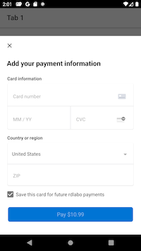
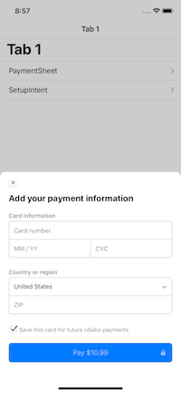
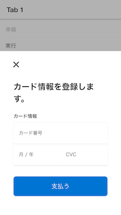
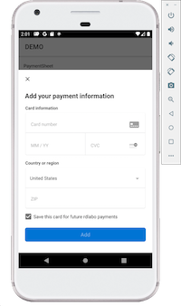
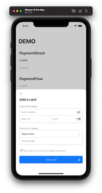
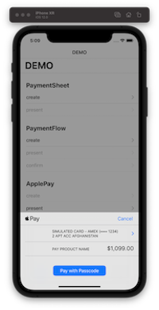
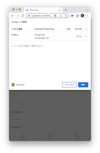
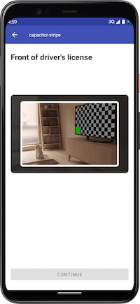
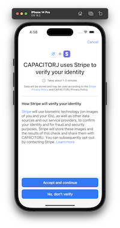
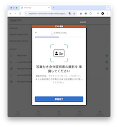

<p align="center"><br></p>

<h3 align="center">Stripe</h3>
<p align="center">
  Capacitor community plugin for native Stripe.
</p>

Documentation: [Payments](https://docs.rdlabo.dev/projects/capacitor-stripe) · [Identity](https://docs.rdlabo.dev/projects/capacitor-stripe-identity) · [Terminal](https://docs.rdlabo.dev/projects/capacitor-stripe-terminal) · [Billing](packages/billing/docs/integration.md)

<p align="center">
  
  <a href="https://www.npmjs.com/package/@capacitor-community/stripe"></a>
</p>

## Choose a package

Each package is independent. Install the integrations your app uses; installing Payment does not install Identity, Terminal, or Billing.

| Package                                                     | Use it for                                                               | Platforms                                         | Start here                                                  |
| ----------------------------------------------------------- | ------------------------------------------------------------------------ | ------------------------------------------------- | ----------------------------------------------------------- |
| [`@capacitor-community/stripe`](packages/payment)           | In-app payments with PaymentSheet, PaymentFlow, Apple Pay, or Google Pay | iOS, Android, web; wallet support varies          | [Payment setup](packages/payment/docs/configuration.md)     |
| [`@capacitor-community/stripe-identity`](packages/identity) | Identity document collection and verification UI                         | iOS, Android, web                                 | [Identity setup](packages/identity/docs/configuration.md)   |
| [`@capacitor-community/stripe-terminal`](packages/terminal) | In-person payments with readers or Tap to Pay                            | iOS, Android; Internet readers only on web        | [Terminal setup](packages/terminal/docs/configuration.md)   |
| [`@capacitor-community/stripe-billing`](packages/billing)   | Subscription buy buttons, Customer Portal, and entitlements              | Experimental: iOS with Swift Package Manager only | [Billing integration](packages/billing/docs/integration.md) |

Payment can confirm a PaymentIntent created by your subscription backend. Billing is the separate integration for Stripe's subscription buy buttons, portal, and entitlement APIs; it is not required just to use PaymentSheet.

## App and backend responsibilities

| Owner         | Responsibilities                                                                                                                                                       |
| ------------- | ---------------------------------------------------------------------------------------------------------------------------------------------------------------------- |
| Your backend  | Authenticate users, choose their Stripe Customer, create Intents and short-lived SDK credentials, verify Stripe webhooks, and authorize fulfillment or feature access. |
| Your app      | Initialize the selected plugin, register listeners before opening Stripe UI, request credentials from your backend, present UI, and handle results.                    |
| These plugins | Bridge the supported Stripe SDK operations to Capacitor. They do not supply your production authentication, server, webhook handler, or subscription catalog.          |

Keep Stripe secret keys on the backend. A device's completed/presented result updates the UI; your server remains responsible for the authoritative payment or verification outcome. See [Payment backend integration](packages/payment/docs/server-integration.md), [Identity sessions and outcomes](packages/identity/docs/identity-verification-sheet.md), [Terminal connection tokens](packages/terminal/docs/collect-a-payment.md), and [Billing Customer Sessions](packages/billing/docs/integration.md).

## Install and configure

Use plugin v8 with Capacitor v8. For example, to add Payment:

```sh
npm install @capacitor-community/stripe@8
npx cap sync
```

Follow the selected package's setup guide for its native permissions, wallet settings, or web dependencies. Web Payment requires `@stripe/stripe-js@^9.17.0` and `stripe-pwa-elements@^4.1.0`; the [web quick start](packages/payment/docs/vanilla-js.md) covers registration. The React provider is optional and initializes **Payment only**. Billing requires a Stripe account enabled for the upstream private preview and has no CocoaPods, Android, or web implementation.

For Capacitor v7, use plugin v7. The v8 guides describe the code in this repository; use the matching release/tag when working with an older version.

## Platform and SDK requirements

| Package  | Android minimum | iOS minimum                                  | Default Stripe Android SDK | Default Stripe iOS SDK                                                                      | Web SDK                                      |
| -------- | --------------- | -------------------------------------------- | -------------------------- | ------------------------------------------------------------------------------------------- | -------------------------------------------- |
| Payment  | API 24          | 15.0                                         | 23.26.x                    | SPM 26.15.1 / CocoaPods 26.15.0                                                             | Stripe.js 9.17.x / stripe-pwa-elements 4.1.x |
| Identity | API 24          | 15.0                                         | 23.26.x                    | SPM 26.15.1 / CocoaPods 26.15.0                                                             | Stripe.js 10.3.x                             |
| Terminal | API 26          | 15.0; Tap to Pay has additional requirements | 5.8.x                      | 5.8.x                                                                                       | terminal-js 0.26.x                           |
| Billing  | Unsupported     | 15.0, SPM only                               | —                          | Pinned experimental revision; see [integration guide](packages/billing/docs/integration.md) | Unsupported                                  |

The Android plugins default to `compileSdkVersion = 36` and `targetSdkVersion = 36`. If you install more than one plugin, your app must satisfy the highest minimum (API 26 when using Terminal).

Optional Android SDK overrides are `stripeAndroidVersion` (Payment), `identityVersion` (Identity), and `stripeterminalCoreVersion`, `stripeterminalTapToPayVersion`, and `stripeterminalAppOnDevicesVersion` (Terminal). Keep Terminal versions aligned and check upstream compatibility before overriding them.

Payment and Identity stay below Stripe iOS 26.16, whose [SPM manifest requires Swift tools 6.1](https://github.com/stripe/stripe-ios-spm/blob/26.16.1/Package.swift). Their CocoaPods dependencies stay on 26.15.0 because [26.15.1 removed CocoaPods distribution](https://github.com/stripe/stripe-ios/blob/26.15.1/CHANGELOG.md). Terminal stays below 6.0: [iOS 6.0 requires iOS 16](https://github.com/stripe/stripe-terminal-ios/releases/tag/6.0.0), and [Android 6.0 updates Kotlin to 2.3.21](https://github.com/stripe/stripe-terminal-android/blob/6.0.0/CHANGELOG.md).

Web Payment stays on Stripe.js 9 because [Stripe.js 10 removed Payment Request Button](https://github.com/stripe/stripe-js/releases/tag/v10.0.0). Identity's Stripe.js dependency is independent. When overriding Identity to an older Android SDK, check that SDK's AGP compatibility.

### Existing CocoaPods projects

If `npx cap sync ios` reports an outdated pod specification, run `pod install --repo-update` from `ios/App`. If the lockfile pins an older Stripe SDK, update the affected pod, for example `pod update StripePaymentSheet`, rather than updating every pod. This applies to Payment, Identity, and Terminal; Billing uses SPM only.

## Try the demos

The [hosted Angular demo](https://capacitor-community-stripe.netlify.app/) exercises supported web flows. It cannot demonstrate native-only Billing, native wallet UI, or phone-based Tap to Pay.

For native flows, build [demo/angular](demo/angular/README.md). Its scenario pages prepare test resources automatically and display method results under EXPECT. Green checks report the listed SDK/API calls, not fulfillment or a completed subscription purchase. Billing scenarios require iOS; its backend is configured once by the maintainer, with no credentials entered by app users.

From a fresh checkout:

```sh
npm ci
npm run build
cd demo/angular
npm ci
npm run cap
npx cap sync ios
npx cap open ios
```

For Android, replace the last two commands with `npx cap sync android` and `npx cap open android`. Demo builds use `environment.prod.ts`; local development setup and backend responsibilities are explained in the [Angular demo guide](demo/angular/README.md) and [demo server guide](demo/server/README.md).

Other examples: [React](demo/react) · [Apps on Devices](demo/app-on-devices).

### Screenshots

#### @capacitor-community/stripe

|              |                     Android                     |                     iOS                     |                     Web                     |
| :----------: | :---------------------------------------------: | :-----------------------------------------: | :-----------------------------------------: |
| PaymentSheet |  |  |  |
| PaymentFlow  |   |   |           Screenshot unavailable            |
|   ApplePay   |                  Not supported                  |      |                    beta.                    |
|  GooglePay   |     |                Not supported                |     |

#### @capacitor-community/stripe-identity

|          |                  Android                   |                  iOS                   |                  Web                   |
| :------: | :----------------------------------------: | :------------------------------------: | :------------------------------------: |
| Identity |  |  |  |

<!-- rdlabo-docs-omit -->

## Maintainer release channels

The repository's npm workspaces are Payment, Identity, Terminal, and Billing. Candidate publishing builds and validates all four as one set.

For an open, non-draft PR, an owner or maintainer may comment `/beta` after Validation and Package Candidate pass. This authorizes only that head SHA; a new commit requires another successful CI run and a new `/beta` request. PRs changing release-gating workflows must first land on `main`.

Candidate versions use `<base>-beta.pr<PR number>.sha<12-character SHA>`. The workflow verifies the package names and versions, then posts an exact install command for the complete set. A merged PR automatically publishes that set to `beta` after CI succeeds for the merge commit. Direct pushes to `main` do not publish a candidate.

Use the root `npm run release` script for coordinated tagged releases. Stable `vX.Y.Z` tags publish every workspace to `latest`; prerelease tags publish every workspace to `next`. Candidate publishing does not change `latest`. Each package must have npm publishing configured, including its Trusted Publisher for GitHub Actions. See [Contributing](CONTRIBUTING.md) for generated documentation and local checks.

<!-- /rdlabo-docs-omit -->

## Maintainers

| Maintainer          | GitHub                                        | Social                                      | Website                               |
| ------------------- | --------------------------------------------- | ------------------------------------------- | ------------------------------------- |
| Hidetaka Okamoto    | [hideokamoto](https://github.com/hideokamoto) | [@hide__dev](https://twitter.com/hide__dev) | [hidetaka.dev](https://hidetaka.dev/) |
| Masahiko Sakakibara | [rdlabo](https://github.com/rdlabo)           | [@rdlabo](https://twitter.com/rdlabo)       | [rdlabo.dev](https://rdlabo.dev/)     |

## Contributors ✨

<a href="https://github.com/capacitor-community/stripe/graphs/contributors">
  
</a>

Made with [contributors-img](https://contrib.rocks).
